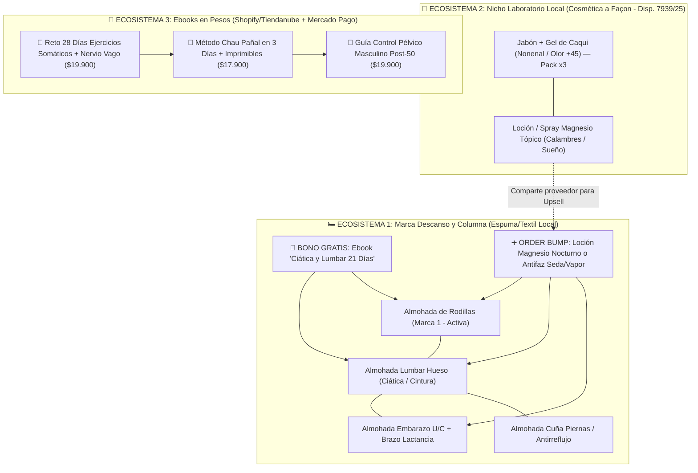

# Comparativa Integral con el Mercado Interno Argentino y Planificación Maestra (31/10/2026)

Revisión cruzada de **todos los últimos relevamientos del 30 y 31 de octubre** (búsqueda en X de `@Br3ntGbs` y `@ecomrudolfs`, espionaje de Ebooks en GetHookd y Meta Ad Library, rankings de GetHookd por dolores y análisis del Kit de Descanso), contrastados contra el **mercado interno argentino** (Google Trends AR, VOCC en Reddit/YouTube/foros locales, regulación ANMAT/Aduana, proveedores nacionales vs. courier y calculadora de rentabilidad en ARS).

> [!summary] Conclusión ejecutiva en 60 segundos
> 1. **El patrón ganador que une X + GetHookd + Argentina**: afuera escalan tiendas monoproducto apalancadas en un **dolor biológico o vergonzante de +40 años o maternidad**, pero cuando las cruzamos con Argentina **el filtro real no es Meta Ads (que está casi vacío en casi todos), sino la fricción operativa (ANMAT, volumen en courier y ancla de precio en Mercado Libre)**.
> 2. **Qué gana en Físicos (Producción Local = Riesgo Cero de Aduana)**:
>    - **Ecosistema 1 — Marca Descanso y Columna (Espuma local)**: **Almohada de Embarazo (U/C)** + **Almohada Lumbar Hueso (Ciática)** sumadas a la **Almohada de Rodillas** (Marca 1). Se fabrican acá (Dubeflex, Jomaro, MTL, micolecho), no pasan por Aduana ni ANMAT, y absorben como **bono gratuito el Ebook de Ciática** (copiando la jugada exacta de *Ciatiflex®* en AR).
>    - **Ecosistema 2 — Nicho Laboratorio Local (Cosmética a Façon)**: **Jabón/Gel de Caqui contra el "Olor de la Edad" (Nonenal)** + **Loción Nocturna de Magnesio Tópico (Calambres/Sueño, modelo *8 Sheep Organics*)**. Se tercerizan en el mismo laboratorio cosmético local (habilitación simplificada por **Disp. ANMAT 7939/2025**), cuestan ~$3.000-$4.500 y se venden en packs de $34.900-$44.900 con recompra mensual.
> 3. **Qué gana en Ebooks / Infoproductos (Flujo de caja rápido en ARS con Mercado Pago)**:
>    - **#1 Reto 28 Días de Ejercicios Somáticos y Nervio Vago** (modelando a *Isabel Navarro*, 172 días activa, cobrando en ARS con voseo).
>    - **#2 Método "Chau Pañal en 3 Días" + Kit Imprimible** (modelando a *Big Little Feelings* 355 d y *Stella Soragi* R$27, diferenciándose por velocidad y precio de la guía médica de la *Dra. Jimena Le Bellot* en AR).
>    - **#3 Nuevo candidato digital: Guía "Control Pélvico Masculino en 21 Días (Post-Próstata)"** (captura el dolor de *Fortis* —374 ads en GetHookd— sin el freno ANMAT de importar un dispositivo médico).
> 4. **Qué se frena o reubica**:
>    - **Antifaz de vapor / Kit de Descanso importado**: **NO-GO como tienda sola**. Puesto en AR por courier el antifaz suelto multiplica ×6-7 su costo FOB (breakeven de la caja x10 = $7.353, inviable en Meta), y 300 kits completos pesan **108 kg** (rompen el tope de 50 kg del régimen courier). Solo sirve como **Order Bump sin aroma** dentro de la marca de almohadas.
>    - **Dispositivo Antiatragantamiento (LifeVac / NovaCare)**: **FREZADO por ANMAT Clase II** y brecha de precio insalvable ($13.495 en MELI vs $129.999 de Airflow Argentina).
>    - **Protector Bucal Bruxismo (GrindGuard)**: **CUIDADO**, el hueco publicitario es gigante (+10.000 vendidos en MELI a $21.999 y 0 marcas DTC), pero los odontólogos argentinos hacen campaña activa en redes diciendo que las placas blandas termomoldeables empeoran el bruxismo. Si se testea, el ángulo tiene que ser *"Placa de emergencia / descanso provisorio en pack x2"* y nunca reemplazar la rígida.

---

## 1. Análisis del Patrón de Búsqueda (X + GetHookd + Biblioteca de Meta)

Al cruzar los hilos de **`@Br3ntGbs`** (Brent CRO) y **`@ecomrudolfs`** en X con las búsquedas por dolor en **GetHookd** y la **Biblioteca de Anuncios de Meta**, aparece un patrón repetible de 5 reglas que separa los productos que escalan de los que mueren:

| Regla del Patrón | Qué vimos en X (`@Br3ntGbs` / `@ecomrudolfs`) | Qué vimos en GetHookd / Meta AR | Cómo aplicarlo al buscar en Argentina |
|---|---|---|---|
| **1. Culpa biológica ("No sos vos, es X")** | **Kaori** (49k → 556k visitas/mes) no dice "estás sucio": presenta un enemigo químico nuevo (**el 2-nonenal** después de los 40) que el jabón común no disuelve. | **Alignex** (337 ads) culpa al "canal espinal que se cierra al acostarte"; ** Isabel Navarro** (172 d) culpa al "cortisol atrapado en el psoas". | El hook en AR tiene que bautizar un **mecanismo culpable externo** (el nonenal, el hueco lumbar a las 3 AM, el reflejo del nervio vago). |
| **2. Economía de pack o consumible oculto** | **The Sprouting Company** (133 ads) no gana con el frasco, gana con las **semillas por suscripción**. **Sweenly** (0 → 222k visitas) vende **pack 3+2 gratis** a USD 59,97. | En AR los costos fijos por pedido (envío ~$7.000 + fulfillment ~$1.500 + CPA ~$15.000) **matan cualquier unidad suelta de menos de $40.000**. | Descartar productos de compra única de ticket bajo salvo que la oferta frontal sea **Pack x3 / Trimestral** o **Kit Completo**. |
| **3. Cruzar Físico ↔ Digital en el mismo dolor** | Afuera **Newmindstart** mete 302 anuncios a un curso de ciática de USD 1, mientras **SmoothSpine** mete 287 anuncios a un masajeador físico. | En AR **Vida Sin Ciática** vende una **crema física (*Ciatiflex®* a $37.900)** y regala el **ebook del Dr. Funes como bono**. | Cuando un dolor tiene traba física (ANMAT), **entrar con un Ebook en ARS**. Cuando el producto físico es fuerte (Almohada Lumbar), **usar el Ebook como bono gratis** para destruir objeciones. |
| **4. Dolor vergonzante = Compra 100% online** | **Jabón de caqui** ("olor a viejo" en la almohada), **incontinencia masculina** (*Fortis*, 374 ads), **hongos en uñas** (*Naturalmente*, 690 días en AR). | Nadie quiere ir a una farmacia de barrio a pedir "jabón para el olor a viejo" o "ejercitador para pérdidas de orina post-próstata". | Priorizar dolores donde el cliente **prefiere comprar en secreto desde el celular** y recibir una caja discreta de Andreani. |
| **5. Soberanía de stock local vs. trampa del courier** | En EE.UU./Europa hacen dropshipping directo desde China en 6 días. | En AR el courier comercial tiene **tope de 50 kg**, honorarios fijos de DHL (~USD 14,8/kg + tasas) y **freno ANMAT** en cosméticos/médicos importados. | Priorizar lo que se fabrica en **espuma/textil local** (Once, Avellaneda, fábricas de poliuretano) o **laboratorio cosmético local a façon**, dejando courier solo para accesorios <50 g no regulados. |

---

## 2. Comparativa Integral contra el Mercado Interno Argentino

### 2.1 Canasta A: Los 6 Candidatos de X (`@Br3ntGbs` y `@ecomrudolfs`)

| Producto (Referencia X) | Dolor y Trends AR (5a / 12m) | VOCC y Contexto Cultural en Argentina | Fricción ANMAT / Proveedor en AR | Unit Economics y Precio MELI AR | Veredicto Antigravity |
|---|---|---|---|---|---|
| **1. Jabón / Gel de Caqui ("Olor de la edad" / Nonenal)** Ref: *Kaori* (556k vis/mes) · *Sap Skin* (357 ads) | [Trends AR](https://trends.google.com/trends/explore?date=today%205-y&geo=AR&q=olor%20a%20viejo,nonenal,jabon%20de%20caqui): pico viral creciente en 12m porque medios masivos locales ([El Cronista](https://www.cronista.com/), [La Voz](https://www.lavoz.com.ar/)) publicaron notas explicando qué es el **2-nonenal** y por qué el jabón común no lo saca. | En foros y comentarios locales la gente repite: *"mi papá se baña todos los días pero su cuarto y las fundas de almohada tienen ese olor a encerrado/grasa vieja"*. En Meta AR **Naturalmente** recién testea hace 16 días sin usar el ángulo de la edad (+45). | **Importarlo es NO-GO** (ANMAT frena cosméticos sin legajo). **Solución limpia**: fabricarlo **a façon en un laboratorio cosmético argentino habilitado** (trámite digitalizado por **Disp. ANMAT 7939/2025**, Grado 1, con extracto de caqui + té verde). | En [MELI AR](https://listado.mercadolibre.com.ar/jabon-caqui) el líder vende +1.000 unidades a $15.447 la barra suelta. Con costo local estimado de ~$2.500-$3.500/barra, el **Pack x3 Barras a $34.900** (o **Kit 2 Barras + 1 Gel Ducha a $42.900**) deja **CPA breakeven de ~$16.000-$21.000**. | 🟢 **GO PRIORITARIO (#1 de X)** Abre la vertical de **Nicho Laboratorio Local**. |
| **2. Kit Germinador de Brotes + Semillas** Ref: *The Sprouting Co.* (133 ads, 114 d) | [Trends AR](https://trends.google.com/trends/explore?date=today%205-y&geo=AR&q=brotes%20de%20brocoli,sulforafano,germinador): nicho chico pero muy fiel en longevidad, nutrición funcional y mujeres +35. "Sulforafano" creció por podcasts de médicos integrativos. | En [MELI AR](https://listado.mercadolibre.com.ar/sulforafano) los suplementos importados de sulforafano (*Swanson*, *SMNutrition*) cuestan una fortuna y tardan semanas; en foros de nutrición destacan que germinar brócoli 4 días en casa da **mirosinasa viva** por una fracción del precio. | **Fricción baja**: frasco de vidrio/acrílico con tapa drenante local + semillas agroecológicas (ej. [FECOAGRO](https://www.fecoagro.com.ar/) o fraccionadores con **RNPA vigente** para no tener que tramitar registro alimentario propio). | En MELI el kit con semillas vende +100 a **$54.000**. Costo local armado estimado ~$10.000-$12.000. Vender **Kit Frasco + 3 Bolsas de Semillas (Brócoli/Alfalfa/Mix) + Guía a $44.900** deja **CPA breakeven ~$20.000**. | 🟡 **GO DE NICHO** Cero competencia en Meta AR, 100% local, pero mercado total más chico que dolor físico. |
| **3. Dispositivo Antiatragantamiento** Ref: *NovaCare* (236 ads) · *Global Health* (268 ads, 239 d) | [Trends AR](https://trends.google.com/trends/explore?date=today%205-y&geo=AR&q=maniobra%20de%20heimlich,atragantamiento): dolor constante en padres de bebés (BLW / papillas) y cuidadores de abuelos con disfagia. | En Meta AR **Airflow Argentina** lleva 155-185 días con pocos anuncios a **$129.999**, pero en [MELI AR](https://listado.mercadolibre.com.ar/dispositivo-antiatragantamiento) está lleno de clones chinos genéricos a **$13.495 - $25.000** (+100 vendidos). | **Fricción ALTA (Bloqueante)**: es un **Producto Médico Clase II** (ANMAT PM) y sociedades médicas en habla hispana lo han cuestionado. Pautar *"salvá una vida"* sin número de PM en la landing expone a denuncia y bloqueo de cuenta. | La brecha entre el clon de MELI ($13.495) y el precio DTC ($99.900-$129.999) hace que el comprador busque en MELI antes de pagar. | 🔴 **NO-GO / PAUSADO** Salvo alianza con importador médico que ya tenga PM aprobado en ANMAT. |
| **4. Esmalte en Marcador (Pack x5)** Ref: *Sweenly* (0 → 222k vis/mes) | [Trends AR](https://trends.google.com/trends/explore?date=today%205-y&geo=AR&q=esmalte%20semipermanente,u%C3%B1as%20en%20casa): el interés por hacerse las uñas en casa subió en AR por el costo de las manicuras, pero nadie busca "esmalte en marcador". | En [MELI AR](https://listado.mercadolibre.com.ar/esmalte-marcador-unas) la gente confunde el producto con los *marcadores de nail art para dibujar florcitas* ($3.500-$18.000). Además, en TikTok las reseñas de marcadores de uña chinos muestran que **dejan rayas o se salen con el agua** si no son gel UV. | **Fricción MEDIA-ALTA**: no se fabrica acá; hay que importarlo de Alibaba y los esmaltes son **cosméticos importados (ANMAT)** + contienen solventes/líquidos que DHL suele restringir como carga peligrosa. | Pack x5 a $34.900 deja poco margen para absorber CPA + envío + devoluciones por calidad del trazo. | 🔴 **NO-GO** Riesgo aduanero (líquidos cosméticos) + alto riesgo de reclamos por calidad. |
| **5. Toalla Refrescante (Verano / Sofocos)** Ref: *CoolTowel* (112 ads) · *MS Support* (260 ads) | [Trends AR](https://trends.google.com/trends/explore?date=today%205-y&geo=AR&q=toalla%20refrescante,sofocos%20menopausia): pico estacional puro de noviembre a febrero. | En [MELI AR](https://listado.mercadolibre.com.ar/toalla-refrescante) es un **commodity quemado** ($7.999 la unidad, packs x10 por $28.591). El único ángulo sobreviviente es **"Sofocos nocturnos / Menopausia +50"**, no gimnasio. | Liviana y textil, pero para este verano (noviembre-febrero) ya no dan los tiempos si hay que producir/importar de cero salvo comprar stock mayorista local en Once. | Ticket bajo ($24.900 el x3) → **CPA breakeven de apenas ~$8.000-$9.000**. | 🔴 **NO-GO como tienda** Solo sirve como regalo/bump de verano si se compra en Once a $2.500. |
| **6. Manta Refrescante para Perros** Ref: *Kovah* (206 ads) · *The Dog Hub* (269 ads) | [Trends AR](https://trends.google.com/trends/explore?date=today%205-y&geo=AR&q=manta%20refrescante%20perro,golpe%20de%20calor%20perros): explota en diciembre-enero en AR con las olas de calor. | En [MELI AR](https://listado.mercadolibre.com.ar/manta-refrescante-perro) ya domina **Gadnic** (+100 vendidos a $66.649) y hay 539 publicaciones desde $32.590. En Meta AR **Comfypetys** domina camas con 270 anuncios. | **Fricción LOGÍSTICA**: contiene gel pesado (1,5 a 3 kg por manta según talle), por lo que **importarla por courier es carísimo** y tiene talles (S/M/L/XL) que parten el stock. | Contra Gadnic en 6 cuotas y envío Full en MELI, el margen DTC comprando a un importador local queda muy fino. | 🔴 **NO-GO** Pesa demasiado para courier y en MELI ya está Gadnic. |

---

### 2.2 Canasta B: Los 3 Ebooks de GetHookd y Meta Ad Library (+ 1 Nuevo de Antigravity)

Acá se cumplió la tarea pendiente de [`Hueco ebooks AR - 31 octubre.md`](file:///C:/Users/WIN-10/Desktop/Ecommerce Curso/Vault%20ECOMAI/05%20Plan%20de%20accion/Hueco%20ebooks%20AR%20-%2031%20octubre.md#L117) (medir Google Trends AR, competencia local en Google y cruce con el hallazgo de [`Espionaje ebooks GetHookd - 31 octubre.md`](file:///C:/Users/WIN-10/Desktop/Ecommerce Curso/Vault%20ECOMAI/05%20Plan%20de%20accion/Espionaje%20ebooks%20GetHookd%20-%2031%20octubre.md)):

| Ebook / Oferta Digital | Ganador Afuera (GetHookd / Meta) | Google Trends AR y Competencia Local en AR | Cómo entra al Ecosistema Argentino | Veredicto y Orden |
|---|---|---|---|---|
| **1. "Reto 28 Días: Ejercicios Somáticos y Reseteo del Nervio Vago"** | **Isabel Navarro** (55-65 ads, **172 días activa**, vende en BRL/USD por Hotmart a $9,90 con 4 bonos). **Newmindstart** (319 ads en somáticos + 97 en psoas). | [Trends AR 5a](https://trends.google.com/trends/explore?date=today%205-y&geo=AR&q=nervio%20vago,ejercicios%20somaticos,cortisol): **"nervio vago"** y **"cortisol"** multiplicaron ×3 su interés en AR en los últimos 24 meses. En librerías argentinas ([Yenny El Ateneo](https://www.yenny-elateneo.com/), [Planeta](https://www.planetadelibros.com.ar/)) el libro físico *"Estimula tu nervio vago"* de Antonio Valenzuela es best-seller, pero en Meta AR **ningún operador local cobra en pesos con Mercado Pago** (Isabel Navarro cobra en moneda extranjera con español neutro y *Patricia Vega MD* cobra en USD). | **Oferta a modelar #1 (M8-03)**: Ebook ilustrado + **videos cortos de 2 minutos sin hablar a cámara** + 4 bonos (Liberación del Psoas, Mapa del Nervio Vago, SOS Ansiedad Nocturna, Audio Guía) a **$19.900 ARS** con Mercado Pago + Order Bump de $9.900. | 🥇 **#1 PARA LANZAR EN EBOOKS** Cumple 100% M8-03 (sin marca personal, 172 días, hueco de cobro en ARS). |
| **2. "Chau Pañal en 3 Días: Método Práctico + Kit Imprimible"** | **Big Little Feelings** (76 ads, **355 días activa**, USD 34). **Potty Training Consultant** (172 d). En Brasil: **Stella Soragi** (15 ads, 55 d, R$27 en Hotmart con kit Montessori imprimible). | [Trends AR 5a](https://trends.google.com/trends/explore?date=today%205-y&geo=AR&q=dejar%20el%20pa%C3%B1al,control%20de%20esfinteres): **pico estacional fortísimo de octubre a febrero en Argentina** (todas las mamás quieren sacar el pañal con el calor del verano y **antes de que empiecen las clases/jardín en marzo**). **Hallazgo clave de Antigravity en Google AR**: la pediatra argentina **Dra. Jimena Le Bellot** ([soymamaypediatra.com](https://soymamaypediatra.com/)) vende una guía grabada de *Control de Esfínteres* con su marca personal, pero **no pauta en Meta AR** (62 anuncios en Meta AR son solo pañales y bombachitas). | Para no chocar con el enfoque médico largo de los pediatras, copiar el ángulo de **Stella Soragi + Big Little Feelings**: **Kit de Acción de Fin de Semana (3 días) + Tablero de Stickers Imprimible para el Baño + Guía de Accidentes Nocturnos** a **$17.900 ARS**. **Estacionalidad perfecta ahora (noviembre-febrero)**. | 🥈 **#2 PARA LANZAR EN EBOOKS** Entra justo en el pico de verano previo al inicio del jardín en marzo. |
| **3. "Ciática y Columna: Plan de Descompresión de 21 Días"** | En [`Espionaje ebooks GetHookd`](file:///C:/Users/WIN-10/Desktop/Ecommerce Curso/Vault%20ECOMAI/05%20Plan%20de%20accion/Espionaje%20ebooks%20GetHookd%20-%2031%20octubre.md) se descubrió que **Thomas W. Brenner** vende un masajeador físico (*SmoothSpine*) y en AR **Vida Sin Ciática** vende la crema física **Ciatiflex® ($37.900 ARS)** regalando la *"Guía CiatiFlex del Dr. Funes"*. | [Trends AR 5a](https://trends.google.com/trends/explore?date=today%205-y&geo=AR&q=ciatica,dolor%20lumbar): dolor masivo y evergreen, pero la gente con un ataque agudo de ciático a las 3 AM busca **alivio mecánico o tópico inmediato**, no ponerse a leer un PDF suelto. | **Reubicación estratégica**: en vez de gastar pauta en venderlo solo, armarlo en 48 hs con Claude/Gamma y ponerlo como **BONO GRATUITO ("Valuado en $24.900 — HOY GRATIS") dentro de la oferta de la Almohada Lumbar Hueso y la Almohada de Rodillas**, y como *lead magnet / abandono de carrito*. | 🔄 **REUBICADO COMO BONO DE LA ALMOHADA LUMBAR** Sube la conversión del producto físico a costo $0. |
| **4. NUEVO (Antigravity): "Control Pélvico Masculino en 21 Días (Post-Próstata y Goteo sin Sondas)"** | En [`Productos GetHookd por dolores`](file:///C:/Users/WIN-10/Desktop/Ecommerce Curso/Vault%20ECOMAI/05%20Plan%20de%20accion/Productos%20GetHookd%20por%20dolores%20-%2030%20octubre.md) **Fortis Control Trainer** tiene **374 anuncios y 176 días** apuntando a hombres +50 con pérdidas de orina y goteo post-miccional. | En Google AR el dolor está validado por el [Centro Argentino de Urología](https://centroargentinodeurologia.com.ar/), [Hospital Posadas](https://www.argentina.gob.ar/) y [Vive Plenitud](https://viveplenitud.com.ar/), pero en [MELI AR](https://listado.mercadolibre.com.ar/electroestimulador-piso-pelvico) solo venden **electroestimuladores con sonda rectal** (que los hombres rechazan por tabú/pudor en foros) o pañales para adultos. En Meta AR solo hay 3 anuncios de un coach. | Transformar el ángulo ganador de *Fortis* (*"10 minutos por día sentado en tu casa, sin sondas, sin pastillas y sin que nadie se entere"*) en una **Guía Digital Discreta en ARS ($19.900)** para hombres +50. Cero ANMAT, cero aduana y compra 100% privada. | 🥉 **#3 PARA TESTEAR EN EBOOKS** Resuelve un dolor vergonzante de 374 ads afuera sin riesgo regulatorio. |

---

### 2.3 Canasta C y D: Últimos Productos Físicos de GetHookd (Dolores, Nuevos y Kit de Descanso) + Nuevos de Antigravity

| Producto | Afuera (GetHookd) | Mercado Interno AR (Meta + MELI + VOCC) | Proveedor y Costo en AR | Veredicto y Rol |
|---|---|---|---|---|
| **1. Almohada de Embarazo (U / C) + Almohada de Brazo Lactancia** ([[Top 3 octubre - Mercado, proveedores y lanzamiento\|Top 3 Oct]] + [[Productos nuevos GetHookd - 30 octubre\|Nuevos GetHookd]]) | *Sleepybelly* (257 ads, 149 d) + *CozyArm* (218 ads, 69 d). | **0 marcas DTC con embudo de dolor en Meta AR**. En MELI vende +1.000 unidades ($54.990 a $95.000). Quejas reales en MELI: *"le falta relleno"* y *"la tela da calor en verano"*. | **100% Fabricación Local** (MTL, micolecho, Hola Luisina, Jomaro/Tapitel). Costo estimado ~$22.000. Vendiendo a **$79.900** (1u) y **$99.900** (Kit con funda fresca de verano + cuña/almohada de brazo *CozyArm*), deja **CPA breakeven de $37.100 a $43.400**. | 🟢 **GO INMEDIATO (Físico #1)** Se suma a la Marca 1 sin tocar Aduana ni ANMAT. |
| **2. Almohada Lumbar Hueso para Dormir (Ciática)** ([[Producto - Almohada lumbar ciatica]]) | *Alignex Pro* (337 ads, 130 d, USD 60 + upsell almohada de rodillas USD 27,95). | En Meta AR nadie vende el rodillo hueso para dormir. En YouTube/TikTok los videos de *"toalla enrollada en el hueco de la cintura"* tienen **160k a 630k vistas**. En AR el ángulo es **"Ciático / Dolor de cintura a las 3 AM"** (no "estenosis"). | **100% Fabricación Local** (9 fabricantes de espuma contactados el 30/10: Dubeflex, Jomaro, Schwartz, etc.). Costo objetivo ≤ $10.000-$12.000. Precio **$49.900** (1u) y **$74.900** (Combo Lumbar + Rodillas) + **Bono gratis Ebook Ciática**. | 🟢 **GO INMEDIATO (Físico #2)** Hermano directo de la Almohada de Rodillas. |
| **3. NUEVO (Antigravity): Loción / Spray de Magnesio Tópico Nocturno** (Ref: *8 Sheep Organics*) | *8 Sheep Organics* escala fuerte en Meta/IG para **calambres nocturnos en el embarazo, piernas inquietas e insomnio**. | En [r/argentina](https://www.reddit.com/r/argentina/) y notas de [La Nación](https://www.lanacion.com.ar/) crece el uso de magnesio transdérmico porque el citrato oral cae pesado al estómago. En MELI solo hay frascos artesanales sin marca ni promesa de descanso nocturno. | **Laboratorio cosmético local a façon** (el mismo que haga el Jabón de Caqui, bajo Disp. ANMAT 7939/2025). Costo estimado ~$3.500-$4.500. Precio **$32.900** (1u) o **$54.900** (Pack x2) o **Upsell post-compra de $24.900** para quienes compran la Almohada de Embarazo o Lumbar. | 🟢 **GO ESTRATÉGICO** Une la Marca de Almohadas con el Nicho Laboratorio Local y mete recompra mensual. |
| **4. Kit de Descanso / Antifaz Autocalentable** ([[Antifaz - competencia y rentabilidad]] + [[Kit de descanso - proveedores]]) | *Lula Eye Mask* (144 ads, 79 d, pero 3 de sus 4 ganadores van al parche de cólicos, no al antifaz). | En [`Antifaz - competencia y rentabilidad`](file:///C:/Users/WIN-10/Desktop/Ecommerce Curso/Vault%20ECOMAI/05%20Plan%20de%20accion/Antifaz%20-%20competencia%20y%20rentabilidad.md) quedó demostrado que el antifaz puesto en AR sale **~$1.032 c/u (×6,7 sobre Alibaba por el flete)** y la caja x10 a $34.900 tiene un **CPA breakeven de apenas $7.353**. Y en [`Kit de descanso - proveedores`](file:///C:/Users/WIN-10/Desktop/Ecommerce Curso/Vault%20ECOMAI/05%20Plan%20de%20accion/Kit%20de%20descanso%20-%20proveedores.md), 300 kits (seda + gel + 10 vapor) pesan **108 kg**, superando el límite de 50 kg del courier. | Si se quiere armar un **Kit de Descanso sin trabarse en Aduana**, armarlo **80% local**: Antifaz de gel (DeOnce $2.000) + Antifaz 3D/satén (taller textil Once/Avellaneda) + Spray de Magnesio/Lavanda local, o traer **solo 500 sobres de vapor sin aroma de Hebei Yinuan (9 kg en courier)** exclusivamente como **Order Bump en el checkout de las almohadas**. | 🟡 **SOLO COMO ORDER BUMP** **NO-GO como tienda independiente**. No importar 108 kg por carga aérea sin antes validar demanda. |
| **5. Protector Bucal Nocturno para Bruxismo** ([[Productos nuevos GetHookd - 30 octubre\|#1 Nuevos GetHookd]]) | *GrindGuard* (97 ads, **332 d**), *Remi* (195 ads, 208 d), *Nattelyst* (132 ads, 216 d), *InnovaLife* (366 d). | Demanda brutal en MELI (**+10.000 vendidos a $21.999**) y **0 marcas DTC en Meta AR** (solo odontólogos a $150.000 y *BruxZen* que vende un masajeador a $119.000). **PERO en Google/Redes AR los odontólogos atacan fuerte las placas blandas termomoldeables** diciendo que dañan la ATM. | Proveedor local (marcas Kros/Gaon o Body Care que ya tiene registro en farmacias) o Alibaba (*thermoformable night guard*). Pack x2 + estuche a **$34.900**. | 🟡 **GO CON CUIDADO EN EL COPY** Posicionar como *"Protector nocturno de descanso / alivio de emergencia en pack x2"*, sin prometer tratamiento odontológico de ATM. |
| **6. Kit Motoquero / Repartidor: Respaldo Lumbar + Panal de Gel** (*MotoCush* + `r/MotosArg`) | *MotoCush* (172 ads, **214 días al aire** en Australia). | En Meta AR **0 marcas venden respaldo o cojín para moto**. En [`r/MotosArg`](https://www.reddit.com/r/MotosArg/) los repartidores de Rappi/PedidosYa y motoqueros se quejan a diario del dolor de cintura y coxis tras 8 hs y dicen que el tradicional *"cuero de oveja (corderito) junta barro y con la lluvia queda inutilizable"*. | Taller local de tapicería de motos / espuma inyectada + base de gel panal (que ya está relevada en el Top 10). Combo a **$54.900 - $64.900**. | 🟢/🟡 **RESERVA DE ALTO POTENCIAL** Océano azul total en Argentina para un público gigante (motos/delivery). |
| **7. Guantes de Compresión para Artritis** ([[Top 3 octubre - Mercado, proveedores y lanzamiento\|Top 3 Oct]]) | *Kovaria* (236 ads, **316 d**), *Everyneeding* (252 ads). | En Meta AR solo *Nova AR* (tienda catálogo, 19 ads). En MELI valen $16.900 (+1.000 vendidos). | Alibaba puesto en AR por courier: **~$4.800 el par** (liviano, no supera 50 kg). **1 par da pérdida**; funciona empujando **Pack x2 pares ($39.900) y x3 pares ($49.900)**. | 🟢 **GO (Courier liviano)** Ideal si se quiere hacer una primera importación chica por DHL sin riesgo de peso. |

---

## 3. Ranking Maestro de Prioridad (Scorecard 0-100 en el Mercado Argentino)

Puntaje calculado bajo las reglas de [[_Reglas - criterios vault ECOMAI]]: **Evidencia afuera (20) + Demanda y Dolor en AR (20) + Hueco en Meta AR (20) + Facilidad Operativa / Sin traba ANMAT-Aduana (20) + Margen / Ecosistema (20)**.

| Pos. | Producto / Oferta | Tipo | Afuera (20) | Dolor AR (20) | Hueco Meta (20) | Operativa AR (20) | Margen / Ecosist. (20) | **Total** | Decisión |
|---|---|---|---|---|---|---|---|---|---|
| **1** | **Almohada Lumbar Hueso (Ciática) + Bono Ebook Ciática** | Físico Local (Espuma) | 19 | 20 | 19 | 18 | 19 | **95/100** | 🟢 **EJECUTAR YA** (Esperando cotización de los 9 proveedores contactados el 30/10) |
| **2** | **Almohada de Embarazo (U/C) + Cuña/Brazo Lactancia** | Físico Local (Textil/Espuma) | 18 | 20 | 20 | 18 | 18 | **94/100** | 🟢 **EJECUTAR YA** (Mismos proveedores locales de Marca 1, cero aduana) |
| **3** | **Ebook #1: Reto 28 Días Ejercicios Somáticos + Nervio Vago** | Digital (ARS / MP) | 19 | 18 | 19 | 20 | 17 | **93/100** | 🟢 **EJECUTAR YA** (Modelar a Isabel Navarro en pesos y con voseo) |
| **4** | **Ebook #2: Chau Pañal en 3 Días + Kit Imprimible** | Digital (ARS / MP) | 18 | 19 | 20 | 20 | 15 | **92/100** | 🟢 **EJECUTAR EN NOVIEMBRE** (Pico estacional de verano en AR) |
| **5** | **Jabón / Gel de Caqui ("Olor de la Edad" / Nonenal) — Pack x3** | Físico Local (Lab a Façon) | 20 | 18 | 18 | 15 | 19 | **90/100** | 🟢 **COTIZAR EN LABORATORIO LOCAL** (Salir antes de que *Naturalmente* escale o descubra el ángulo +45) |
| **6** | **Loción Nocturna de Magnesio Tópico (Calambres / Sueño)** | Físico Local (Lab a Façon) | 17 | 18 | 19 | 16 | 19 | **89/100** | 🟢 **COTIZAR JUNTO AL CAQUI** (Mismo laboratorio; sirve de upsell para Embarazo y Lumbar) |
| **7** | **Ebook #3: Control Pélvico Masculino 21 Días (Post-Próstata)** | Digital (ARS / MP) | 19 | 17 | 19 | 20 | 13 | **88/100** | 🟢 **TESTEAR COMO 3.º EBOOK** (Captura el dolor de *Fortis* sin ANMAT) |
| **8** | **Guantes de Compresión Artritis (Pack x2 / x3 pares)** | Físico Courier (Alibaba) | 18 | 18 | 17 | 16 | 15 | **84/100** | 🟢/🟡 **OPCIÓN #1 SI SE QUIERE IMPORTAR POR COURIER** |
| **9** | **Kit Motoquero / Delivery (Respaldo Lumbar + Gel)** | Físico Local / Mixto | 17 | 19 | 20 | 14 | 14 | **84/100** | 🟡 **SEGUNDA OLA** (Validar con taller de tapicería local) |
| **10** | **Kit Germinador de Brotes + 3 Semillas (Sulforafano)** | Físico Local | 16 | 14 | 20 | 17 | 16 | **83/100** | 🟡 **SEGUNDA OLA** (Asegurar proveedor de semillas con RNPA) |
| **11** | **Protector Bucal Bruxismo (Pack x2 Termomoldeable)** | Físico Local / Courier | 19 | 20 | 19 | 11 | 13 | **82/100** | 🟡 **CON CAUTELA** (Riesgo ANMAT odontológico y objeción de dentistas) |
| **12** | **Antifaz de Vapor Autocalentable (Sin Aroma)** | Físico Courier | 11 | 15 | 18 | 10 | 14 | **68/100** | 🟠 **SOLO ORDER BUMP** (No cierra CPA como tienda sola; no pasar de 50 kg) |
| **13** | **Dispositivo Antiatragantamiento / Esmalte Marcador / Manta Perro / Toalla** | Físicos Importados | — | — | — | 6 | 8 | **<60/100** | 🔴 **DESCARTADOS / FREZADOS** (ANMAT Clase II, líquidos en courier o peso/commodity en MELI) |

---

## 4. Arquitectura de Ecosistemas (Cómo Conectar Todo sin Dispersarse)

En lugar de abrir 8 tiendas desconectadas, todos los ganadores aprobados encajan en **2 Marcas Físicas Nacionales + 1 Línea de Infoproductos en Pesos**:

---

## 5. Planificación Operativa de 6 Semanas (Noviembre – Diciembre 2026)

### 📅 Semana 1 (2 al 8 de noviembre): Cierre de Proveedores Locales y Producción del Ebook #1
1. **Marca Descanso (Almohada Lumbar + Embarazo)**:
   - Recibir las cotizaciones de los **9 fabricantes contactados el 30/10** (Dubeflex, Jomaro, Schwartz, Tapitel, SleepTime, Ozz, MTL, CAMSI, Fábricas Unidas).
   - **Regla de filtro**: elegir al que entregue la **forma de hueso tallada real** (no el cilindro liso) por **≤ $10.000-$12.000** y pedir en el mismo contacto cotización mayorista de la **Almohada de Embarazo en U con cierre regulable** (objetivo ≤ $22.000, empezando por MTL y micolecho).
2. **Nicho Laboratorio (Jabón de Caqui + Loción de Magnesio)**:
   - Pasar el candidato **Jabón de Caqui contra el Nonenal** a archivo formal `Producto - Jabon de caqui nonenal.md` en `06 Analisis compartido/`.
   - Contactar **5 laboratorios cosméticos terceristas (a façon) en AMBA** con legajo ANMAT vigente (ej. *Oxapharma*, laboratorios de cosmética natural/dermocosmética de CABA y Zona Norte) pidiendo MOQ y costo para: (a) Barra/Gel con extracto de caqui y té verde, y (b) Loción de cloruro de magnesio + lavanda.
3. **Ebooks (Somáticos + Bono Ciática)**:
   - Abrir la landing de **Isabel Navarro** (`herramientas-somaticas.netlify.app`) para desglosar su estructura exacta.
   - Generar con Claude + Gamma + Canva el **Ebook "Ciática 21 Días"** (25 págs., como bono gratuito de las almohadas) y el **Ebook #1 "Reto 28 Días de Ejercicios Somáticos"** + sus 4 bonos.

### 📅 Semana 2 (9 al 15 de noviembre): Muestras Físicas y Lanzamiento del Ebook #1 (Somáticos)
1. **Lanzamiento Ebook #1 (Somáticos en ARS)**:
   - Montar landing en voseo rioplatense con cobro en **pesos vía Mercado Pago** ($19.900 + Order Bump de $9.900 con *Sell Easy* / checkout).
   - Grabar/editar 5 creativos (videos editables de ejercicios de liberación de psoas/cuello + carrusel de síntomas de cortisol alto) y lanzar **test CBO de USD 50** (criterio de corte del vault: **mínimo 5 ventas con USD 50**, CPA ≤ $10.000-$12.000).
2. **Muestras de Espuma (Lumbar y Embarazo)**:
   - Aprobar muestra física de la **Almohada Lumbar Hueso** y de la **Almohada de Embarazo**.
   - Grabar los primeros 5 videos UGC/demostrativos de la Almohada Lumbar usando los 3 ángulos validados: *"El hueco en el colchón a las 3 AM"*, *"Chau a la toalla enrollada que se desarma"* y *"Por qué la almohada de rodillas necesita soporte en la cintura"*.

### 📅 Semana 3 (16 al 22 de noviembre): Lanzamiento Almohada Lumbar + Armado Ebook #2 (Chau Pañal)
1. **Lanzamiento Almohada Lumbar Hueso (en la tienda de Marca 1)**:
   - Oferta frontal: **1u a $49.900** · **Combo Cintura + Rodillas a $74.900 ("El más elegido")** · **Pack x2 a $84.900**, todos con el **Ebook Ciática 21 Días GRATIS**.
   - Test de USD 50-100 en Meta Ads AR (criterio: CPA ≤ $20.000-$22.000 en unidad o ≤ $28.000 en combo).
2. **Armado y Lanzamiento de Ebook #2 ("Chau Pañal en 3 Días" + Kit Imprimible)**:
   - Aprovechar el inicio del calor de fines de noviembre. Precio: **$17.900 ARS** + Order Bump de *"Guía de Sueño Infantil / Berrinches"* a $8.900.

### 📅 Semana 4 (23 al 29 de noviembre): Lanzamiento Almohada Embarazo + Definición Laboratorio (Caqui)
1. **Lanzamiento Almohada de Embarazo (U/C)**:
   - Oferta: **1u a $79.900** · **Kit Maternidad Completo (Almohada U + Funda fresca de verano + Almohadita de brazo lactancia) a $99.900** en 3/6 cuotas.
   - Activar tanto el ángulo para la embarazada (*"dolor de cadera al dormir del lado izquierdo"*) como el **ángulo de regalo para la pareja** de cara a las fiestas de diciembre.
2. **Definición del Lote Piloto de Jabón de Caqui (Nonenal)**:
   - Si el laboratorio local entrega costo ≤ $3.500-$4.000/u con inscripción ANMAT Grado 1 bajo su legajo, encargar primera tanda chica para salir con **Pack x3 a $34.900** y el ángulo exclusivo **"Después de los 40 no es sudor, es nonenal"** (en video UGC, donde *Naturalmente* hoy no compite porque solo usa imágenes genéricas).

### 📅 Semanas 5 y 6 (30 de noviembre al 13 de diciembre): Escala de Navidad y Verano
1. **Escalar los ganadores** que hayan superado las 5 ventas por cada USD 50 invertidos.
2. **Campaña de Regalos Útiles (Navidad)** en las marcas físicas:
   - En Embarazo: ángulo *"El mejor regalo de Navidad para una embarazada no es ropa de bebé, es volver a dormir"*.
   - En Descanso/Columna: *"Regalale a tus viejos despertarse sin dolor de cintura"*.
3. **Evaluar segunda ola**: si queda ancho de banda operativo, abrir el test del **Ebook #3 (Piso Pélvico Hombres)** o el lote courier liviano de **Guantes de Compresión (Pack x2/x3)**.

---

## 6. Resumen de Reglas de Corte (Disciplina de Capital)

| Formato | Presupuesto de Test | Métrica para Escalar (GO) | Métrica para Cortar / Iterar (STOP) |
|---|---|---|---|
| **Ebooks ($17.900 - $19.900)** | USD 50 (~$78.000 ARS) | **≥ 5 ventas** (CPA ≤ $15.000 ARS) y take rate del Order Bump ≥ 20% | < 3 ventas con USD 50 → cambiar hook/ángulo; si tras 2 giros sigue igual, pasar al siguiente ebook. |
| **Almohada Lumbar ($49.900 / Combo $74.900)** | USD 100 (~$156.000 ARS) | **CPA ≤ $22.000** en 1u o **≤ $30.000** en Combo (ROAS ≥ 2,5) | Si el CTR del video es < 1,2%, rehacer los primeros 3 segundos mostrando el "hueco bajo la cintura". |
| **Almohada Embarazo ($79.900 / Kit $99.900)** | USD 100 (~$156.000 ARS) | **CPA ≤ $32.000** (ROAS ≥ 2,5) | Si hay muchos carritos abandonados por el ticket, destacar las **cuotas sin interés** y el uso doble embarazo + 12 meses de lactancia. |
| **Jabón de Caqui Pack x3 ($34.900)** | USD 50-80 | **CPA ≤ $14.000** (ROAS ≥ 2,5 en primera compra + recompra a los 60 días) | Nunca vender barra suelta: si piden 1 sola unidad, que cueste $19.900 + envío pago para forzar el Pack x3 de $34.900 con envío gratis. |
